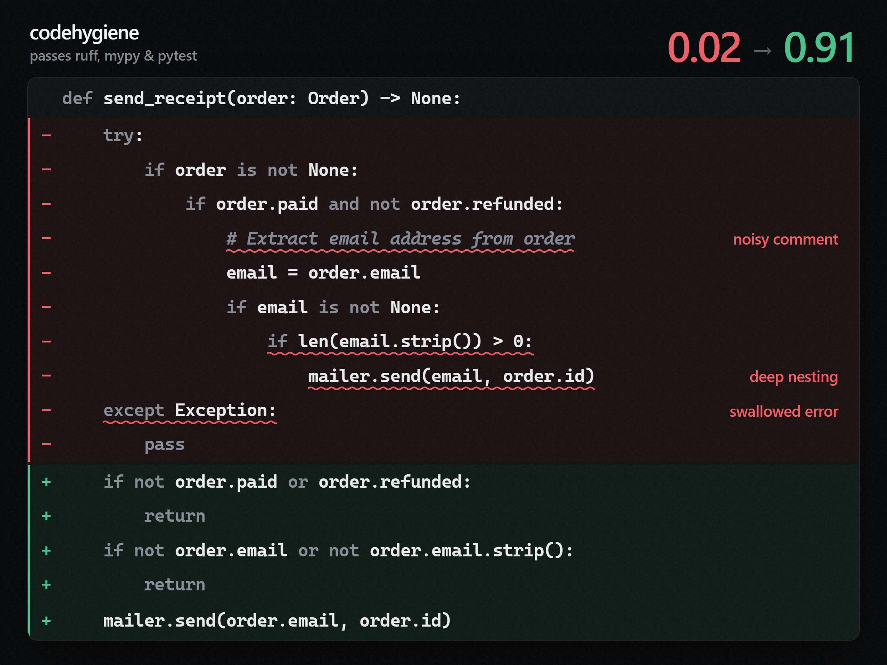

# codehygiene

A 13 KB, 1.58-bit ternary weight-space programmed System One model for code readability and hygiene.

**[Try it on any GitHub repository →](https://brianbell-x.github.io/codehygiene/)**



Traditional linters check syntax and formatting rules—code can pass every linter and unit test while still reading like cryptic golf or deeply nested, over-commented, copy-pasted AI slop. Instead of maintaining separate AST rules per language or calling a slow LLM judge, `codehygiene` runs a compact `599K`-parameter `1.58-bit` ternary neural network in pure NumPy (`~10 ms` on CPU across macOS, Linux, and Windows) for 11 languages (`Python`, `C`, `C++`, `Rust`, `Go`, `Zig`, `JavaScript`, `TypeScript`, `Java`, `C#`, `Lua`):

- **1.58-bit ternary weight-space programmed:** No training data or gradient descent is used. Every 2D/3D weight, convolution, causal, attention, and embedding matrix in `weights.npz` has entries strictly in `{-1, 0, +1}` (`594,974` trits packed at `5` trits/byte + `4,323` 1D channel scales/biases = `13.0 KiB`), compiled directly from explicit mathematical circuits in `compile.py`.
- **System One judgment:** No text is generated. A single forward pass returns calibrated `0.0–1.0` hygiene scores, 6 style sub-scores, a style archetype, and line-level `Squiggle` diagnostics.

## Example Output

```text
corpus/regressions/readme_example.py
  score: 0.001  rl_hygiene: 0.003  style: slop (100%)
    flatness        #............... 0.05
    naming          ###############. 0.91
    simplicity      ###############. 0.91
    comments        #####........... 0.30
    error_handling  #####........... 0.30
    layout          ##########...... 0.65

  4 squiggle(s):
     2 |     # Validate user items
       |     ~~~~~~~~~~~~~~~~~~~~~ [noisy_comment 0.89] Comment restates code or leaves TODO/lint noise
     8 |                     if x.score > 0:
       |                     ~~~~~~~~~~~~~~~ [deep_nesting 0.88] Deep nesting; flatten with guard clauses
     9 |                         return run(x)
       |                         ~~~~~~~~~~~~~ [deep_nesting 0.88] Deep nesting; flatten with guard clauses
    12 |     except Exception:
       |     ~~~~~~~~~~~~~~~~~ [swallowed_error 0.88] Ignored error or silent fallback value
```

## Quickstart

Install as a cross-platform agent skill (Claude Code, Codex, Cursor, Antigravity, Copilot on macOS, Linux, and Windows) with bundled offline weights via `npx skills`:

```bash
npx skills add brianbell-x/codehygiene     # current project
npx skills add brianbell-x/codehygiene -g  # global across all projects
```

Or run the CLI directly via `uvx` / `pip`:

```bash
uvx --from git+https://github.com/brianbell-x/codehygiene codehygiene .
pip install git+https://github.com/brianbell-x/codehygiene
```

## Interactive Browser Demo (`docs/`)

Live on GitHub Pages: **[https://brianbell-x.github.io/codehygiene/](https://brianbell-x.github.io/codehygiene/)**

A zero-backend client-side repository scorer and playground is included in `docs/`. Any public GitHub repository URL (`https://github.com/owner/repo`) or pasted snippet is scored locally in the browser: the `13.04 KiB` `weights.npz` archive is unpacked via `DecompressionStream("deflate-raw")` and executed across a parallel Web Worker pool (`Float32Array`), producing a codebase hygiene summary, filterable directory scores, live squiggle underlines, polyglot **Before / After** presets, and an optional **Circuit X-ray** inspector (`Block 0` byte-grid masks and `Block 3` line probabilities):

```bash
python3 -m http.server 8123 -d docs
```

## CLI

Directories, file paths, globs, and piped `stdin` are accepted:

```bash
codehygiene .                              # recursively lint supported source files
codehygiene src/ --check                   # exit 1 if any squiggle >= threshold (CI / agent gate)
codehygiene path/to/file.py --json         # structured JSON for coding agents & tooling
codehygiene "src/*.go" -t 0.60 --no-color  # custom squiggle probability threshold
cat snippet.rs | codehygiene --json        # evaluate raw source from stdin
```

## Python & RL Reward API

```python
import codehygiene

res = codehygiene.score(code)                        # full Result object (~10 ms on CPU)
issues = codehygiene.lint(code, threshold=0.55)      # list[Squiggle]
reward = codehygiene.rl_reward(code, tests_passed=True, weight=0.25)
```

In RL coding loops (`GRPO`, `PPO`, verifiers), `rl_reward` is gated by test pass rate: broken solutions (`tests_passed <= 0`) always receive `0.0` so models cannot reward-hack by emitting clean-looking non-functional code, while passing solutions receive `1.0` to `1.25` based on code hygiene.

## How It Works

All inference happens in `_forward()` (`codehygiene/__init__.py`) using standard matrix multiplies, 1D convolutions, and attention—with zero regexes, tokenizers, or AST parsers:

1. **2D ASCII Byte Grid (`encode_byte_grid`):** Source text is placed into a `(lines × 128 columns)` grid of 7-bit ASCII bytes, preserving visual indentation, alignment, and line width.
2. **Left-to-Right String & Comment Masking (`Block 0`):** Causal prefix matrices scan across each line to track quote parity (`"` / `'`) and comment openers (`//`, `# `, `-- `, `/* */`), preventing words inside strings or comments from misfiring code detectors.
3. **Pattern Convolutions & Word-Stem Sketches (`Block 1`):** Parallel `k=3, 7, 13` convolutions detect control-flow branches, chained operators, ceremonial naming (`*Factory`, `*Manager`), and golfed short-variable or magic-index soup (`xx = ...`, `[112]`), while 40 SimHash filters sketch 4-letter identifier stems separately in code and comments.
4. **Cross-Line Sink Attention & Readout (`Blocks 2–3`):** Multi-head attention compares each line against neighbors (`±32` lines) and file-wide indentation statistics—catching comments whose stems repeat the next line's code (`noisy_comment`), swallowed error handlers (`swallowed_error`), duplicated blocks (`duplicate_block`), and deep pyramids (`deep_nesting`)—before issue density (the gated mean over non-blank lines) is pooled into file-level scores, so a long file is not scored lower for its length.

## Output Schema (`--json` / `Result.to_dict()`)

| Field | Type | Description |
| :--- | :--- | :--- |
| `score` | `float` `[0, 1]` | Overall aesthetic score (`>= 0.70` clean, `0.40–0.70` mixed, `< 0.40` degraded). It follows issue density per non-blank line, not file length. |
| `rl_hygiene` | `float` `[0, 1]` | Anti-slop structural hygiene signal tailored for RL reward shaping. |
| `scores` | `dict[str, float]` | Six `[0, 1]` sub-scores: `flatness`, `naming`, `simplicity`, `comments`, `error_handling`, `layout`. |
| `archetype` | `str` | Closest style profile: `minimal`, `clean`, `enterprise`, `dense`, or `slop`. |
| `archetype_probs` | `dict[str, float]` | Probability distribution summing to `1.0` across all 5 style profiles. |
| `squiggles` | `list[dict]` | `{line, col_start, col_end, probability, kind, message}` diagnostics above `threshold`. |

Squiggle `kind` values: `deep_nesting`, `poor_naming`, `noisy_comment`, `swallowed_error`, `dense_line`, `special_casing`, `duplicate_block`, `cramped_layout`.

Mean `score` by squiggle density, measured with `v0.4.1` on `2,758` files (`925,397` lines) from 15 public repositories:

| Squiggles per 100 lines | `0` | `0–1` | `1–2` | `2–4` | `4–6` | `6–9` | `9–14` | `14+` |
| :--- | :---: | :---: | :---: | :---: | :---: | :---: | :---: | :---: |
| Files | `962` | `231` | `298` | `466` | `282` | `206` | `162` | `138` |
| Mean `score` | `0.872` | `0.861` | `0.821` | `0.748` | `0.602` | `0.413` | `0.162` | `0.023` |

Issue registers below the squiggle threshold also count toward density, and a snippet of a few lines with one squiggle has a high density, so it scores low.

## Benchmarks

Evaluated with zero training across a 54-slice production canon (`27` files, `11` languages), annotated polyglot/anti-golf diagnostic suites, and `28` static AI-slop & defensive-paranoia circuits across `float32` (`v0.2`) and `1.58-bit` ternary (`v0.3`, `v0.4`) compilations:

| Metric | `float32` (`v0.2`) | `1.58-bit` Ternary (`v0.3`) | `1.58-bit` Ternary (`v0.4`) | `1.58-bit` Ternary (`v0.4.1`) |
| :--- | :---: | :---: | :---: | :---: |
| **Matrix weight domain** | `float32` (`32.00` b/w) | `{-1, 0, +1}` (`425,044` trits) | **`{-1, 0, +1}` (`569,662` trits, `1.60` b/w)** | **`{-1, 0, +1}` (`594,974` trits, `1.60` b/w)** |
| **Uncompressed payload (`trits` + `vecs`)** | `1,668.41 KiB` | `95.74 KiB` | **`127.30 KiB`** (`111.28 KiB` trits + `16.03 KiB` vecs) | **`133.10 KiB`** (`116.22 KiB` trits + `16.89 KiB` vecs) |
| **Compressed `weights.npz` on disk** | `33.03 KiB` (`33,821 B`) | `10.52 KiB` (`10,772 B`) | **`12.97 KiB` (`13,281 B`)** | **`13.04 KiB` (`13,348 B`)** |
| **Cold `.npz` load + unpack latency** | `8.03 ms` | `4.68–5.06 ms` | **`5.67 ms`** | `6.85 ms` |
| **Warm CPU latency (`12` / `65` / `391` lines)** | `9.68` / `69.2` / `464.6 ms` | `9.70` / `50.4` / `346.1 ms` | **`10.24` / `63.6` / `410.9 ms`** | `10.0` / `56.2` / `451.8 ms` |
| **Controlled diagnostic AUROC** (clean vs. messy) | `1.000` | `1.000` | **`1.000`** | not re-run |
| **Core squiggle & anti-golf recall** | `100%` (`14 / 14`) | `100%` (`14 / 14`) | **`100%` (`14 / 14`)** | not re-run |
| **Static AI-slop & paranoia recall** (`5` families) | `0%` (`0 / 28`) | `0%` (`0 / 28`) | **`100%` (`28 / 28`)** | not re-run |
| **Production canon squiggle rate** (`11` languages) | `1.99` / 100 lines | `2.05` / 100 lines | **`2.05` / 100 lines (`0` new FPs)** | not re-run |
| **Clean trap & repository self-lint false positives** | `1` (`catch` reset) | `1` (`catch` reset) | **`0` (`22 / 22` clean traps)** | not re-run |

The `v0.4.1` latency row was measured on a different machine and inputs than the earlier columns; on that machine the `v0.4.0` weights measured `9.4` / `55.5` / `424.8 ms`, so the two added attention heads cost `+1%` to `+7%`. The diagnostic, canon, and trap suites behind the last five rows are not part of this repository and were not re-run for `v0.4.1`; the circuits changed in `v0.4.1` are covered by the checked-in cases in [`corpus/regressions/`](corpus/regressions/).

### File Length and Squiggle Changes (`v0.4.0 -> v0.4.1`)

`v0.4.0` max-pooled every issue register into the document heads, so a long file paid about one logit for each squiggle kind that fired anywhere in it. Re-scoring the same `2,758` files from 15 public repositories:

| File length (lines) | Files | Squiggles / 100 lines | Mean `score` (`v0.4.0`) | Mean `score` (`v0.4.1`) |
| :--- | :---: | :---: | :---: | :---: |
| `< 50` | `737` | `2.04` | `0.792` | `0.769` |
| `50–150` | `696` | `3.75` | `0.681` | `0.725` |
| `150–400` | `659` | `4.29` | `0.495` | `0.682` |
| `400–1,000` | `415` | `5.61` | `0.277` | `0.623` |
| `1,000+` | `251` | `5.91` | `0.109` | `0.585` |

Pearson `r` between `log(lines)` and `score` moved from `-0.69` to `-0.24` (`-0.71` to `-0.14` with squiggle density held fixed), and `r` between squiggle density and `score` moved from `-0.55` to `-0.78`. `noisy_comment` squiggles fell from `1,714` to `724` and `swallowed_error` from `1,841` to `1,813`; every other kind stayed within `3` lines of its `v0.4.0` count.

## Agent Corpus Benchmark (GPT-OSS 120B Before / After)

Evaluated in a controlled two-phase agent benchmark where `GPT-OSS 120B (Medium)` first built four dependency-free subsystems and frozen 8-scenario test suites without `codehygiene` (`before/`), then refactored each copy (`after/`) under `codehygiene/SKILL.md` and `codehygiene --check` (`v0.4.0`) while keeping all `64 / 64` tests green. Scores below are from `v0.4.1`:

| App | Language | Before Score | After Score | Delta | Squiggles (`B -> A`) | `rl_reward` (`B -> A`) | Tests (`B / A`) |
| :--- | :--- | :---: | :---: | :---: | :---: | :---: | :---: |
| `billing_python` | Python | `0.814` | **`0.848`** | `+0.034` | `7 -> 0` | `1.2054 -> 1.2156` | `8/8 · 8/8` |
| `gateway_js` | JavaScript | `0.825` | **`0.912`** | `+0.087` | `5 -> 0` | `1.2058 -> 1.2278` | `8/8 · 8/8` |
| `checkout_ts` | TypeScript | `0.770` | **`0.904`** | `+0.134` | `8 -> 0` | `1.1921 -> 1.2256` | `8/8 · 8/8` |
| `matching_rust` | Rust | `0.162` | **`0.868`** | **`+0.705`** | `33 -> 0` | `1.0648 -> 1.2195` | `8/8 · 8/8` |
| **Mean / Total** | **4 langs** | **`0.643`** | **`0.883`** | **`+0.240`** | **`53 -> 0`** | **`1.1670 -> 1.2221`** | **`64 / 64`** |

Three of the four `before/` files carry `2.1` to `3.5` squiggles per 100 lines, so their density-based scores sit near `0.8`; the squiggle counts, not the score delta, show what the gate removed.

```bash
python3 corpus/evaluate.py --check --run-tests
```

Full sub-score breakdowns, squiggle distributions, and concrete agent failure modes caught during refactoring are documented in [`corpus/README.md`](corpus/README.md).

## Build Weights

All `32` ternary `{-1, 0, +1}` matrices (`594,974` trits packed at `5` trits per `uint8` byte, `93.8%` zero) and `4,323` 1D scale/bias scalars in `codehygiene/weights.npz` (`13.04 KiB`) are deterministically generated from `compile.py`:

```bash
python3 compile.py
```

## References

- **Weight-Space Programming:** Rikiya Takehi, Jayden Teoh, Alex Zhang, and Omar Khattab, [*Sparks of Weight-Space Programming: LLMs can natively read & write neural network weights*](https://rikiyat.github.io/blog/weight-space-programming/), MIT CSAIL (2026) · [code & logs](https://github.com/rikiyat/lm_understand-logs)
- **Interpretable Weight-Space Programming (iWSP):** Chandan Singh et al., [*Interpretable weight-space programming builds transparent transformers and brain encoding models*](https://www.alphaxiv.org/pdf/2611.interpretable-weight-space-programming) (2026) · [code](https://github.com/csinva/weight-space-programming-autoresearch)
- **1.58-Bit Ternary Networks (BitNet b1.58):** Shuming Ma et al., [*The Era of 1-bit LLMs: All Large Language Models are in 1.58 Bits*](https://arxiv.org/abs/2402.17764) (2024)
- **System One Decision Models:** TypeSafe [*System One*](https://docs.typesafe.ai/concepts/system-one.md) (`noul`, `score`, and `choice` typed probability primitives without text generation) and Cloudflare *Clef*
- **Polyglot Calibration Canon:** Structural circuits and thresholds calibrated against production source from [Redis](https://github.com/redis/redis), [SQLite](https://www.sqlite.org/src), [Lua](https://github.com/lua/lua), [TigerBeetle (`TIGER_STYLE`)](https://github.com/tigerbeetle/tigerbeetle/blob/main/docs/TIGER_STYLE.md), [Go standard library](https://cs.opensource.google/go/go), [Node.js](https://github.com/nodejs/node), [ripgrep](https://github.com/BurntSushi/ripgrep), [OpenBSD](https://github.com/openbsd/src), [LevelDB](https://github.com/google/leveldb), [Starlette](https://github.com/encode/starlette), [Requests](https://github.com/psf/requests), [Hono](https://github.com/honojs/hono), [Svelte](https://github.com/sveltejs/svelte), [HikariCP](https://github.com/brettwooldridge/HikariCP), and [.NET Runtime](https://github.com/dotnet/runtime)
