# codehygiene

An `8.20 KiB`, zero-vocabulary `1.58-bit` ternary model for 2D code geometry and structural readability.



`30` zero-vocabulary `{-1, 0, +1}` tensors (`448,498` trits packed at `5` trits/byte + `4,814` 1D channel scales/biases across `42` vectors) are deterministically compiled from [`compile.py`](compile.py) into [`codehygiene/weights.npz`](codehygiene/weights.npz) (`8,400` bytes) without training data, tokenizers, regexes, AST parsers, or English word tables, and executed in pure NumPy or browser `Float32Array` workers across `20+` languages (`Python`, `TypeScript`, `JavaScript`, `Rust`, `Go`, `C`, `C++`, `C#`, `Java`, `Ruby`, `Swift`, `Kotlin`, `Zig`, `SQL`, `Perl`, `Visual Basic`, `Fortran`, `MATLAB`, `Lua`, and `PHP`).

## Zero-Vocabulary `(L × 128)` Byte-Grid Geometry

Every source file is encoded as a full-file `(L × 128)` 7-bit ASCII byte grid with zero line-count truncation. Alphabetic (`a–z`, `A–Z`) and numeric (`0–9`) bytes enter only uniform character-class masks and symmetric cross-line SimHash self-similarity; arbitrary domain identifiers (`_U_CRYPTO_OLD = 62`, `arr_old`, `ent_old`, `*Manager`) carry zero lexical weights anywhere in the model (`Δscore = 0.000000` under identifier renaming and random bijective `[a-zA-Z]` alphabet permutations on pure-geometry circuits).

Six structural squiggle kinds complement syntax formatters (`ruff`, `prettier`, `eslint`, `rustfmt`, `gofmt`, `clang-format`) on newly written or modified diffs:

| Squiggle `kind` | 2D Byte-Grid Trigger | Clean Idioms Passed (`0` Squiggles) |
| :--- | :--- | :--- |
| `deep_nesting` | Pyramid control flow (`4+` compound indent steps inside a function/method) | Early-return guard clauses, flat `match`/`switch` arms, class-method baselines |
| `dense_line` | Chained `.a().b().c()` call trains, nested `? :` ternaries, `;`-packed statements, or wide unwrapped code (`>96–110` cols) | Multiline calls, string-heavy log/SQL lines, single inline expressions |
| `cramped_layout` | Unbroken `20+` line imperative statement walls or ragged off-grid indentation | Paragraph-paced functions, tabular constant/array literals, aligned signatures |
| `duplicate_block` | Copy-pasted or alpha-renamed `4+` line imperative stanzas `4–31` lines apart | Distinct domain steps, short struct/field initializers, data tables |
| `repetitive_structure` | `4+` parallel `if x == lit` equality-comparison branch ladders | Lookup maps, dispatch tables, `2–3` concise branch checks |
| `comment_echo` | Standalone narrator comments echoing next-line code, `// ...` / `# ...` elisions, or `2+` lines of commented-out code | Multi-line prose/math derivations, Python `>>>` doctests, ASCII dividers, docblocks |

Functional bugs, type errors, and security vulnerabilities are out of scope; newly written or modified diffs are targeted rather than full-repository sweeps.

## Usage

### CLI & Agent Skill

```bash
# Install offline agent skill (Claude Code, Codex, Cursor, Antigravity, Copilot)
npx skills add brianbell-x/codehygiene -g
npx skills update codehygiene -y

# Gate touched files, globs, directories, or stdin (exits 1 if any squiggle >= threshold)
uvx --from git+https://github.com/brianbell-x/codehygiene codehygiene path/to/changed.py --check
codehygiene "src/*.rs" -t 0.55 --json --no-update-check
```

Clean files print nothing under `--check`. A flagged file prints its flagged lines and a `target:` byte-grid silhouette (`■` = two code bytes, `<-N` = source line) that `_forward` has verified scores cleaner:

```text
sync.go  0.233/1 -> 0.881/1
    9!|                             if sink.Send(item.ID, item.Payload) {
   10!|                                 sent += 1
  target:
    3 |   ■■,■■■:=■■■■■■■{
    4 |     ■■■:■■■  <-4..8
    5 |     ■■■:■■■■  <-4..8
    6 |
    7 |     ■■■■■■(■■■,■■■■■■){  <-9
    8 |      ■■■=■  <-10
    9 |   }
```

### Python & RL Reward Shaping

```python
import codehygiene

res = codehygiene.score(code)                                        # Result(score, squiggles, line_probs)
issues = codehygiene.lint(code, threshold=0.55)                      # list[Squiggle]
target = codehygiene.project_target_grid(code)                       # target_score, target_slice
reward = codehygiene.rl_reward(code, tests_passed=True, weight=0.15) # test-gated [0, 1] bonus
```

- **Diagnostics (`Result` / `--json`):** `score` (`[0, 1]` geometric cleanliness), `line_probs` (`(L, 6)` per-line probabilities), and `squiggles` (`{line, col_start, col_end, probability, kind, message}`); `--json` adds `target_score` and `target_grid` when a cleaner grid is found.
- **RL reward (`rl_reward`):** Gated multiplicatively on `tests_passed` (`False` always yields `0.0`), pooled over docstring-masked Bayesian means (`_PRIOR_LINES = 16`) and span-damped 32-line peak-window densities, and damped by `1 / (1 + 1.5 * load^0.85)` over telescopic-span, severity-weighted squiggle events (`weight=0.10–0.25` inside test-verified `GRPO`/`PPO` loops).

### Browser & Node.js (`Float32Array` Parity)

```javascript
import { unpackNpzBuffer, scoreCode, computeRlReward } from "codehygiene/engine.js";

const weights = await unpackNpzBuffer(await (await fetch("/weights.npz")).arrayBuffer());
const res = scoreCode(sourceText, weights, 0.55); // { score, squiggles, lineProbs }
const reward = computeRlReward(res, true, 0.15);
```

## Architecture

Inference is executed in [`codehygiene/__init__.py`](codehygiene/__init__.py) (`_forward`) and [`codehygiene/engine.js`](codehygiene/engine.js) (`forwardModel`) strictly via matrix multiplies, 1D convolutions, causal prefix sums, and banded relative-position attention:

1. **Block 0 — Column Prefix & Masking:** `tok_emb (128, 52)` + `col_emb (128, 52)` -> `pre_conv3` -> horizontal causal prefix -> `gate1` (`130` channels: 32-quote parity for `"` / `'` / `` ` ``, polyglot comment & Zig `\\` raw-string openers, inline bracket depth) -> `col_fuse` (`68` cell channels evaluated over occupied `row_len + 6` spans with string-discounted `C2_EFF_LEN` effective column width).
2. **Block 1 — Multi-Scale Line Convolutions, Multiline State & Sketches:** Column pool `col_sum_proj (68, 34)` + L3-tiled `im2col` ribbon convolutions `conv3_w (3, 68, 66)` and `conv7_w (7, 68, 45)` + vertical `"""`/`'''`/`/* */` sawtooth state (`ml_proj`, `ml_gate_w`) + 32-step Dyck parenthesis balance, previous-line comment, and nonblank-gated step-in contour taps (`ml_paren_w`) + three 40-dim L2-normalized SimHash sketches (`code`, `comment`, and alpha-invariant operator `skeleton`) + `lmlp1 (727, 79)` -> `lmlp2 (79, 89)` assembled into `Z` (`L × 209`: `89` geometric registers + `120` SimHash dims).
3. **Block 2 — Banded Cross-Line Sink Attention:** Two `O(L)` relative-position passes over `±32` lines with Bayesian sink priors (`bsink`): Pass 1 applies `10` content/relative heads (`head_dim = 40`, including exact 40-dim comment/statement cosine on Head 0, 36-column QR code-clone projection on Heads 5–6, and Paley operator-skeleton projection on Heads 7–8) + `cmlp1`; Pass 2 applies `4` relative-offset smoothing heads (`4 × 2 = 8` channels) + `cmlp2`.
4. **Block 3 — Geometric Readout Heads:** Per-line 6-kind squiggle head (`sq_w`) + docstring-masked Bayesian mean (`_PRIOR_LINES = 16`) and span-damped 32-line peak-window density pooling into paired-clamp saturating `doc1` / `doc2` (`score`).

## Deterministic Compilation

[`compile.py`](compile.py) compiles all `30` ternary matrices and `42` 1D scale/bias vectors directly into [`codehygiene/weights.npz`](codehygiene/weights.npz), enforcing compile-time zero-vocabulary matrix proofs (`verify_zero_vocabulary_invariance`) and built-in geometric boundary checks before writing weights:

```bash
python3 compile.py
python3 -m codehygiene codehygiene compile.py --check --no-color --no-update-check
```

## Benchmarks

Verification separates deterministic offline invariance, polyglot recall/trap, JS parity, and held-out corpus checks (**Tier 1**, `$0.00`) from live external wild-code sanity and refactor-suggestion audits via TypeSafe `Jev` (**Tier 2**, `typesafe/jev-1.14-20261014`: `0 / 44` `"looks crazy"` squiggles across `18` unseen wild/stdlib modules and user repros; `8 / 8` single-file cleanup suggestions judged `genuinely_cleaner`).

| Benchmark / Invariance Metric | `v0.5.1` (`14.85 KiB`) | `v0.6.1` (`23.84 KiB`) | `v0.7.0` (`8.20 KiB`) |
| :--- | :---: | :---: | :---: |
| **Ternary archive (`weights.npz`)** | `14.85 KiB` | `23.84 KiB` (`1,244,706` trits) | **`8.20 KiB` (`30` tensors · `448,498` trits)** |
| **Zero-vocabulary matrix proof & `_old <-> _cur` delta** | No | No (`0.0731`, `5` FPs) | **Verified · `0.000000` (`0` sq)** |
| **Bijective `[a-zA-Z]` 5-seed spread** (pure geometry) | — | `0.142+` | **`0.000000` (`0` sq)** |
| **Pre-compile 2D byte-grid boundary blueprint** | — | — | **`36 / 36` pairs (`72 / 72` grids)** |
| **Controlled recall & clean traps** | `18 / 18` · `0 / 18` FPs | `18 / 18` · `0 / 18` FPs | **`18 / 18` · `0 / 20` FPs (AUROC `1.000`)** |
| **20-language clean traps** (dev / held-out) | `8 / 39` (`86` FP sq) | `35 / 39` (`10` FP sq) | **`39 / 39` (`23/23` · `16/16`, `0` FPs)** |
| **Issue & circuit regression suites** | `2 / 2` suites | `6 / 6` suites | **`6 / 6` (`0/70` repro · `0/64` FP · `15/15` guards)** |
| **Cleanup & anti-hack edit pairs** | — | `4 / 4` anti-bloat | **`8 / 8` cleanup · `5 / 5` anti-hack (`+0.000` jump)** |
| **Adversarial (`+40` helpers / `+200L` doc / `>2,048L` tail)** | `+0.007` / `4` sq | `+0.012` / `4` sq | **`+0.0155` / `0.070` / `6` tail sq** |
| **Python vs. [`codehygiene/engine.js`](codehygiene/engine.js) parity** | `0.0000` | `0.0000` | **`0.0000` (`308` files `|Δ| <= 3.88e-6`)** |
| **Held-out CPython 3.13 stdlib squiggle rate** (`25` files, `25,306L`) | `1.90 / 100` lines | `1.77 / 100` lines (`447` sq) | **`1.24 / 100` lines (`315` sq)** |
| **Held-out CPython 3.13 stdlib median score** (all / `<650L`) | `0.391` / `0.588` | `0.370` / `0.459` | **`0.708` / `0.750`** |
| **Held-out Go module cache squiggle rate** (`352` files, `60,302L`) | `1.66 / 100` lines | `1.22 / 100` lines (`737` sq) | **`0.42 / 100` lines (`253` sq)** |
| **Self-hygiene across all public repo modules** | `0` sq | `0` sq (`0.868`) | **`0` sq (`0.828–0.887` across `6 / 6`)** |
| **Warm CPU latency** (`12` / `65` / `333` / `2,649` lines) | `~7` / `~35` / `~200` / `~1,500 ms` | `~6` / `~23` / `~109` / `~975 ms` | **`4.2` / `15.8` / `77.8` / `685 ms`** |

## References

- Rikiya Takehi, Jayden Teoh, Alex Zhang, Omar Khattab — [*Sparks of Weight-Space Programming*](https://rikiyat.github.io/blog/weight-space-programming/), MIT CSAIL (2026) · [code](https://github.com/rikiyat/lm_understand-logs)
- Chandan Singh et al. — [*Interpretable weight-space programming builds transparent transformers and brain encoding models*](https://www.alphaxiv.org/pdf/2611.interpretable-weight-space-programming) (2026) · [code](https://github.com/csinva/weight-space-programming-autoresearch)
- Shuming Ma et al. — [*The Era of 1-bit LLMs: All Large Language Models are in 1.58 Bits*](https://arxiv.org/abs/2402.17764) (2024)
- TypeSafe [*System One*](https://docs.typesafe.ai/concepts/system-one.md) (`Jev`) and Cloudflare *Clef*
- Calibration canon: [Redis](https://github.com/redis/redis), [SQLite](https://www.sqlite.org/src), [Lua](https://github.com/lua/lua), [TigerBeetle](https://github.com/tigerbeetle/tigerbeetle/blob/main/docs/TIGER_STYLE.md), [Go stdlib](https://cs.opensource.google/go/go), [Node.js](https://github.com/nodejs/node), [ripgrep](https://github.com/BurntSushi/ripgrep), [OpenBSD](https://github.com/openbsd/src), [LevelDB](https://github.com/google/leveldb), [Starlette](https://github.com/encode/starlette), [Requests](https://github.com/psf/requests), [Hono](https://github.com/honojs/hono), [Svelte](https://github.com/sveltejs/svelte), [HikariCP](https://github.com/brettwooldridge/HikariCP), [.NET Runtime](https://github.com/dotnet/runtime)
